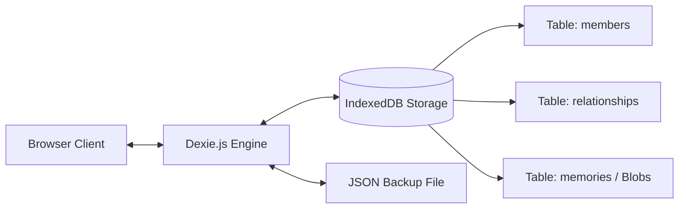

<div align="center">

# 🌿 Kinora

### *Family Heritage & Visual Memories Canvas*

**Version 0.0.1**

[](package.json)
[](LICENSE)
[](#-installation--setup)
[](https://nodejs.org)
[](#-data-privacy--storage)
[](#-design-system)

*A privacy-first, local-first interactive family tree and photographic memory vault designed for seamless touch and mobile-first experience.*

---

</div>

## 📖 Table of Contents

- [About Kinora](#-about-kinora)
- [Key Features](#-key-features)
- [Design System & Aesthetics](#-design-system--aesthetics)
- [Installation & Setup](#-installation--setup)
  - [Ubuntu / Debian / Linux Mint](#1-ubuntu--debian--linux-mint)
  - [Fedora / RHEL / Rocky Linux](#2-fedora--rhel--rocky-linux)
  - [Arch Linux / Manjaro / EndeavourOS](#3-arch-linux--manjaro)
  - [openSUSE](#4-opensuse)
  - [Alpine Linux](#5-alpine-linux)
  - [macOS](#6-macos)
  - [Windows](#7-windows)
- [Running Kinora](#-running-kinora)
- [User Guide & Navigation](#-user-guide--navigation)
- [Data Privacy & Storage Architecture](#-data-privacy--storage-architecture)
- [Project Directory Structure](#-project-directory-structure)
- [Roadmap](#-roadmap)
- [License](#-license)

---

## 🌿 About Kinora

Kinora is an open-source, client-side, local-first family tree application. Built for families, genealogists, and memory keepers who value complete data sovereignty, Kinora runs entirely within your browser.

Traditional family tree platforms lock your ancestry behind subscriptions and cloud databases. Kinora stores 100% of your records, biographies, and compressed photographic memories on your own local device using **IndexedDB**, working completely offline with zero tracking, external servers, or account requirements.

---

## ✨ Key Features

- **🎯 Mobile-First Interactive Canvas (`@xyflow/react`):**
  - Smooth hardware-accelerated touch panning and pinch-to-zoom.
  - Multi-gesture viewport navigation with dynamic controls that fade during canvas movement to eliminate visual obstruction.
- **⭕ Minimalist Circular Member Nodes:**
  - Compact circular avatar portraits (`w-16 h-16`) with centered names underneath in elegant typography.
  - Living vs. In-Loving-Memory indicator pips, photo counter badges, and glowing selection halos.
  - Quick "+" touch triggers to connect relatives in seconds.
- **〰️ Organic Curved Lineage Edges:**
  - Smooth cubic Bezier curves connect parent-to-child generations and spousal partnerships without harsh zig-zags.
  - Automatic generation hierarchy alignment powered by **Dagre**.
- **🍏 macOS-Inspired Floating Glass Dock:**
  - Translucent frosted glass bottom dock ergonomically positioned in the natural thumb-reach zone.
  - Squircle app-style tiles with spring magnification physics and floating tooltips.
- **📸 Apple Photos-Inspired Memories Vault:**
  - Full-bleed photographic memory tiles with cinematic gradient scrims and overlaid titles.
  - Horizontally scrollable **People & Faces** carousel for instant member photo filtering.
  - Client-side image compression ensures lightning-fast performance and minimal storage footprint.
  - Full-screen dark-backdrop **Lightbox Viewer** with keyboard shortcuts (`Esc`, `←`, `→`).
- **🛡️ 100% Data Sovereignty & Portability:**
  - One-click JSON backup export and instant drag-and-drop restore across any browser or computer.

---

## 🎨 Design System & Aesthetics

| Component | Specification |
| :--- | :--- |
| **Color Space** | Pure **OKLCH** tokens for perceptual uniformity, vibrant accents, and clean contrast. |
| **Brand & Titles** | [`Lobster Two`](https://fonts.google.com/specimen/Lobster+Two) — warm, heirloom cursive script for titles and memory headings. |
| **Interface & Body** | [`Raleway`](https://fonts.google.com/specimen/Raleway) — refined geometric sans-serif for high legibility across dates and bios. |
| **Surfaces & Glass** | Ultra-soft warm parchment canvas (`oklch(98.2% 0.008 85)`) paired with frosted glass (`backdrop-blur-2xl`). |
| **Shadows & Borders** | Multi-layered ambient shadows and subtle translucent borders (`border border-[oklch(88% 0.015 80)]`). |

---

## 📦 Installation & Setup

Kinora requires **Node.js (v20.x or higher)** and **npm**. Choose your platform below for step-by-step instructions:

### 1. Ubuntu / Debian / Linux Mint

```bash
# 1. Update package index
sudo apt update

# 2. Install Node.js (v20 LTS) and Git
curl -fsSL https://deb.nodesource.com/setup_20.x | sudo -E bash -
sudo apt install -y nodejs git

# 3. Verify installation
node -v   # Should output >= v20.0.0
npm -v    # Should output >= 10.0.0

# 4. Clone repository & install dependencies
git clone https://github.com/your-username/kinora.git
cd kinora
npm install
```

### 2. Fedora / RHEL / Rocky Linux

```bash
# 1. Update packages
sudo dnf check-update

# 2. Install Node.js & Git
sudo dnf module install -y nodejs:20
sudo dnf install -y git

# 3. Verify installation
node -v
npm -v

# 4. Clone repository & install dependencies
git clone https://github.com/your-username/kinora.git
cd kinora
npm install
```

### 3. Arch Linux / Manjaro

```bash
# 1. Install Node.js, npm, and Git via Pacman
sudo pacman -Syu nodejs npm git

# 2. Verify installation
node -v
npm -v

# 3. Clone repository & install dependencies
git clone https://github.com/your-username/kinora.git
cd kinora
npm install
```

### 4. openSUSE

```bash
# 1. Install Node.js & Git via Zypper
sudo zypper refresh
sudo zypper install nodejs20 npm20 git

# 2. Clone repository & install dependencies
git clone https://github.com/your-username/kinora.git
cd kinora
npm install
```

### 5. Alpine Linux

```bash
# 1. Install Node.js, npm, and Git
sudo apk update
sudo apk add nodejs npm git

# 2. Clone repository & install dependencies
git clone https://github.com/your-username/kinora.git
cd kinora
npm install
```

### 6. macOS

Using [Homebrew](https://brew.sh):

```bash
# 1. Install Node.js
brew install node git

# 2. Clone repository & install dependencies
git clone https://github.com/your-username/kinora.git
cd kinora
npm install
```

### 7. Windows

Using Windows Terminal and `winget` (or download from [nodejs.org](https://nodejs.org)):

```powershell
# 1. Install Node.js LTS
winget install OpenJS.NodeJS.LTS

# 2. Clone repository & install dependencies
git clone https://github.com/your-username/kinora.git
cd kinora
npm install
```

---

## 🚀 Running Kinora

### Development Server
Starts the local development server with hot-module replacement (HMR):
```bash
npm run dev
```
Open your browser at **`http://localhost:5173`**.

### Production Build
Compiles TypeScript and creates an optimized static asset bundle:
```bash
npm run build
```
The compiled files will be located in the `dist/` directory.

### Preview Production Build
Locally preview the production build before deployment:
```bash
npm run preview
```

---

## 🎮 User Guide & Navigation

### 1. Canvas Navigation & Gestures
- **Pan / Move:** Drag anywhere on the canvas with your finger or mouse.
- **Pinch-to-Zoom:** Pinch inward or outward on mobile screens to smoothly zoom generations in and out.
- **Auto-Align:** Tap the **"Align"** button on the top-right header to automatically sort the family into clean generational tiers.
- **Fit Tree:** Tap **"Fit Entire Tree"** to center all members in the screen.

### 2. Managing Family Members
- **Add Person:** Tap the **"Add"** squircle on the bottom macOS dock to create a new person.
- **Connect Relative:** Tap any circular member node, then tap the small "+" button to link a Parent, Spouse, Child, or Sibling.
- **Profile Details:** Tap any member avatar to slide open their biographical drawer, view life dates, age, occupation, and family connections.

### 3. Preserving Memories (Photos & Stories)
- **Attach Memory:** Tap **"Memories"** on the bottom dock or inside a profile drawer to upload a photo.
- **Automatic Compression:** Photos are compressed on your machine to save storage while preserving crisp visual fidelity.
- **Tag People:** Tag family members present in the memory. Photos automatically appear in each tagged member's profile!
- **Lightbox Navigation:** Click any memory to open full-screen view. Use **Left / Right arrow keys** or swipe to browse through memories, and **Esc** to close.

---

## 🔒 Data Privacy & Storage Architecture

Kinora is engineered with a strict **Local-First** model:



- **No Remote Servers:** All names, life dates, stories, and photographs are stored in browser-managed IndexedDB on your hardware.
- **Zero Tracking:** No analytics, trackers, or cookies are loaded.
- **Backup & Restore:** Under the bottom dock's **"More"** menu, choose **"Export Backup (JSON)"** to download your complete family tree into a portable `.json` file. You can restore this archive on any computer at any time.

---

## 📁 Project Directory Structure

```
Kinora/
├── index.html                  # HTML entry with Lobster Two & Raleway Google Fonts
├── vite.config.ts              # Vite + Tailwind v4 + Path alias config
├── tsconfig.app.json           # Modern TypeScript configuration
└── src/
    ├── main.tsx                # App entry
    ├── App.tsx                 # Main layout, state coordination & modals
    ├── index.css               # OKLCH color tokens, animations & canvas styling
    ├── types/
    │   ├── member.ts           # FamilyMember model
    │   ├── relationship.ts     # Relationship model (parent-child, spouse)
    │   └── memory.ts           # Memory photo and story model
    ├── db/
    │   ├── kinoraDb.ts         # Dexie.js IndexedDB schema, export/import & cascade deletes
    │   └── seedData.ts         # Starter family tree (Vance lineage)
    ├── components/
    │   ├── canvas/
    │   │   ├── FamilyCanvas.tsx    # React Flow canvas wrapper with minimap
    │   │   ├── MemberNode.tsx      # Minimalist circular member node
    │   │   └── CanvasToolbar.tsx   # Top header & macOS floating glass dock
    │   ├── profile/
    │   │   ├── ProfileDrawer.tsx   # Slide-over profile sheet with lineage links
    │   │   ├── MemberFormModal.tsx # Add/edit member form
    │   │   └── AddRelativeModal.tsx# Wizard to link parents, spouses, children
    │   └── memories/
    │       ├── AddMemoryModal.tsx    # Photo upload & compression modal
    │       ├── MemoryLightbox.tsx    # Full-screen photo lightbox inspector
    │       └── MemoriesFeedModal.tsx # Full family memory album gallery
    └── utils/
        ├── layoutTree.ts        # Dagre hierarchical tree layout calculation
        └── imageCompression.ts # Client-side image optimizer
```

---

## 🗺️ Roadmap

- [x] Version 0.0.1: Interactive canvas, circular nodes, curved Bezier lineage, Apple Photos-style gallery, macOS floating dock, IndexedDB persistence.
- [ ] Version 0.0.2: Audio / voice memory recordings ("Grandma narrating the story").
- [ ] Version 0.0.3: Timeline scrubber (view family tree in 1950s, 1970s, 2000s).
- [ ] Version 0.0.4: GEDCOM standard file import/export for Ancestry.com interoperability.
- [ ] Version 0.0.5: Native desktop builds via Tauri for Linux (`.deb`, `.rpm`, `.AppImage`), macOS (`.dmg`), and Windows (`.msi`).

---

## 📄 License

This project is licensed under the [MIT License](LICENSE) — free to use, modify, and distribute.

---

<div align="center">
  <sub>Preserving generational lineage and memories with privacy and care.</sub>
</div>
